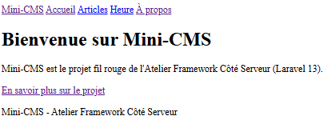
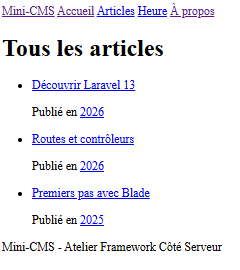
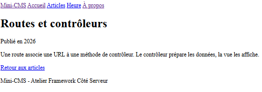

# Mini-CMS — Atelier Framework Côté Serveur

Projet fil rouge réalisé avec **Laravel 13** dans le cadre de l’Atelier Framework Côté Serveur.

## Présentation

Mini-CMS est une application web développée avec Laravel. Ce projet permet de découvrir les bases du développement côté serveur avec PHP et le framework Laravel.

## Technologies utilisées

- PHP 8.3
- Laravel 13
- Composer
- Node.js et npm
- Blade
- Tailwind CSS
- Vite
- Git et GitHub

## Prérequis

- PHP 8.3 ou version compatible
- Composer
- Node.js et npm
- Git

## Installation

### Bash (Linux / macOS)

```bash
git clone https://github.com/maram595/exlaravel.git
cd exlaravel
composer install
cp .env.example .env
php artisan key:generate
npm install
```

### PowerShell (Windows)

```powershell
git clone https://github.com/maram595/exlaravel.git
cd exlaravel
composer install
Copy-Item .env.example .env
php artisan key:generate
npm install
```

## Lancer le projet

Pour démarrer l'application et les outils de développement :

```bash
composer run dev
```

Ouvrir ensuite l'application à l'adresse suivante :

http://localhost:8000

## État actuel (tag lab-02)

- Routes nommées, toutes servies par des contrôleurs : `PageController` pour les pages et `PostController` pour les articles.
- Articles stockés dans un tableau PHP, sans base de données pour l'instant.
- Layout Blade `<x-layout>` avec Tailwind CSS chargé par Vite.
- Base de données SQLite locale dans `database/database.sqlite`, non versionnée.

## Routes disponibles

| Méthode | URI | Nom | Action |
|---|---|---|---|
| GET | `/` | `home` | `PageController@home` |
| GET | `/a-propos` | `about` | `PageController@about` |
| GET | `/heure` | `time` | `PageController@time` |
| GET | `/posts` | `posts.index` | `PostController@index` |
| GET | `/posts/archive/{year}` | `posts.archive` | `PostController@archive` |
| GET | `/posts/{slug}` | `posts.show` | `PostController@show` |

## Captures d'écran

### Accueil avec le layout



### Liste des articles



### Détail d'un article



## Auteur

- **Nom :** Slama Maram
- **Groupe :** MDW32

## Licence

Projet pédagogique réalisé dans le cadre de l’Atelier Framework Côté Serveur.
